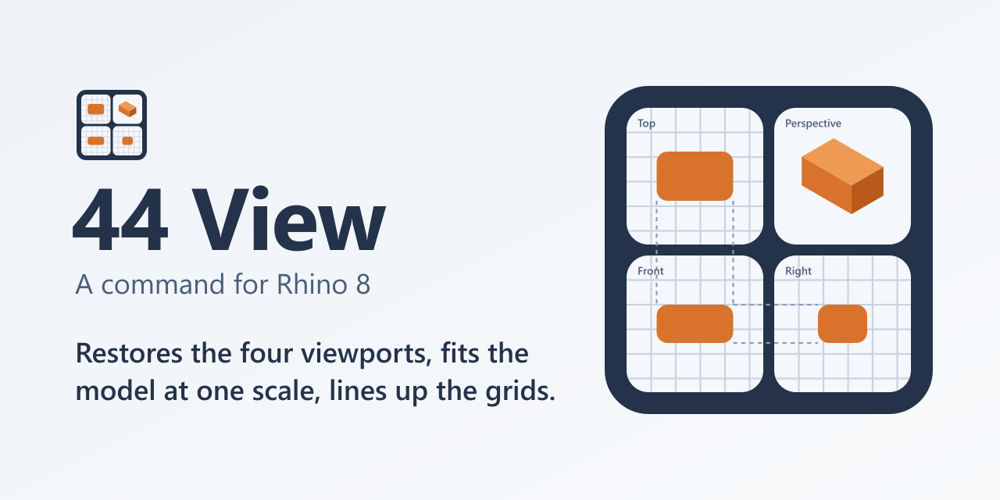

# 44 View for Rhino

A Rhino 8 command that brings back the four default viewports with the model
fitted in every one of them. `44View` restores the Top, Front, Right and
Perspective layout, frames the model in the three parallel views at one shared
scale so their grid lines run straight across the viewport borders, fits the
Perspective view, and saves the four cameras as named views.

Current version: `1.0.0-alpha.0.0.0` (see [CHANGELOG.md](CHANGELOG.md)).



## Build and Install

Build from source with the .NET SDK, then load the resulting `.rhp` into Rhino
by whichever install route fits.

### Build

Requirements: the .NET 8 SDK (or newer) and Rhino 8 for Windows, service
release 8.20 or later.

```bash
dotnet build src/FourFourView/FourFourView.csproj -c Release
```

The plugin builds to `src/FourFourView/bin/Release/net8.0/FourFourView.rhp`.

Rebuilding while Rhino is open works: a running Rhino keeps the loaded `.rhp`
locked, so the build moves the locked file aside (as `FourFourView.rhp.locked-*`)
and writes a fresh one next to it. The new build loads on the next Rhino
restart, and later builds remove the set-aside copies once their Rhino has
exited.

### Install to Rhino

Pick one:

1. **Drag and drop**: drag `FourFourView.rhp` from the build output onto an
   open Rhino window. Rhino loads and registers it in place.
2. **Manual copy**: copy `FourFourView.rhp` and `FourFourView.deps.json` from
   the build output to a folder of your choice, such as
   `C:\Users\<user>\AppData\Roaming\FourFourView\`, then drag the `.rhp` onto
   Rhino once to register it from there.
3. **Package (yak)**: build a package, then install it from the folder it was
   built in.

   ```bash
   dotnet build src/FourFourView/FourFourView.csproj -c Release
   mkdir -p dist/misc
   cp src/FourFourView/bin/Release/net8.0/FourFourView.rhp dist/
   cp src/FourFourView/bin/Release/net8.0/FourFourView.deps.json dist/
   cp manifest.yml docs/assets/icon.png dist/
   cp README.md dist/misc/README.md
   cp LICENSE dist/misc/LICENSE.txt
   cd dist
   "/c/Program Files/Rhino 8/System/Yak.exe" build
   "/c/Program Files/Rhino 8/System/Yak.exe" install --source "$(pwd -W)" 44-view 1.0.0-alpha.0.0.0
   ```

   `yak build` writes `44-view-1.0.0-alpha.0.0.0-rh8_0-any.yak`. Restart Rhino
   after installing; Rhino looks for new packages only at startup. To remove
   the package, run `Yak.exe uninstall 44-view`.

## Usage

Type `44View`. The command:

1. Measures the selected objects, or every visible object when nothing is
   selected.
2. Restores the four default viewports: Top, Perspective, Front and Right.
3. Fits Top, Front and Right at one shared scale, centered on the model, with
   the margin Rhino's Zoom Extents leaves.
4. Fits the Perspective view in its default direction.
5. Saves the four cameras as the named views Perspective, Top, Front and Right.


Type `-44View` to change the options first:

```text
Press Enter to fit the four views ( Source=Auto  Padding=10  SaveViews=Yes  Layout=Yes )
```

| Option | Default | What it does |
| --- | --- | --- |
| `Source` | `Auto` | `Auto` measures the selection when there is one and every visible object otherwise. `Visible` and `Selected` force one or the other. |
| `Padding` | Rhino's Zoom Extents border, normally `10` | Space left around the model, as a percent of its size, in the view that needs the most room. |
| `SaveViews` | `Yes` | Saves the four cameras as named views, replacing named views with the same names. |
| `Layout` | `Yes` | Restores the four default viewports first. `No` fits the Top, Front, Right and Perspective views where they are. |

The choices made in `-44View` become the defaults for `44View`. The options
also work in macros and toolbar buttons:

```text
! _-44View _Source=_Selected _Padding=5 _Enter
```

`44View` replaces the cameras of the four views, as `4View` does, and Rhino's
Undo does not change views. To keep a camera, save it as a named view under
another name before running the command.

Scripts run the same fit through the plugin object:

```python
import rhinoscriptsyntax as rs

views = rs.GetPlugInObject("FourFourView")
views.FitWith("Selected", 5.0, True, True)
print(views.LastReport)
```

See [docs/usage.md](docs/usage.md) for every option, the report fields and the
limitations.

## How it works

Fitting each view on its own leaves Top, Front and Right at three different
scales, so their grids stop lining up. `44View` works out the scale each
parallel view needs, uses the largest of the three in all of them, and centers
every view on the model. Views that share an edge then show the same span of
the model along that edge, which is what carries the grid lines across the
border. [docs/how-it-works.md](docs/how-it-works.md) walks through an example
with numbers.

## Documentation

The documentation site is <https://jhauga.github.io/rhino3d-44-view/>:
installation, usage, how the fit works, publishing and the roadmap. The same
pages live in [docs/](docs/).

## Tests

`powershell -File tests\run-tests.ps1` runs three suites: unit tests of the fit
math, which need no Rhino, and smoke and regression suites that run inside
Rhino 8 and measure the fitted viewports directly. See
[tests/README.md](tests/README.md).

## License

MIT. See [LICENSE](LICENSE).
