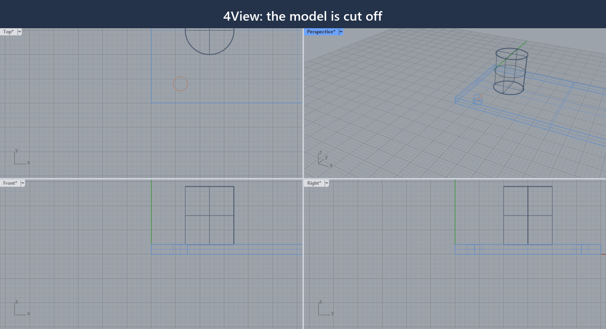

# 44 View

`44View` is a Rhino 8 command that restores the four default viewports and
fits the model in every one of them. Top, Front and Right share one scale and
one center, so the grid lines run straight across the viewport borders, and
the four cameras are saved as named views.



## Get started

1. Build the plugin and install it. See [Installation](installation.md).
2. Open a model in Rhino 8.
3. Type `44View`.

The command line confirms what was fitted:

```text
44View: fitted 5 visible objects at 0.0825 mm per pixel, limited by Top; named views saved.
```

## Pages

- [Installation](installation.md): requirements, building, and three ways to
  install.
- [Usage](usage.md): the command, its options, macros, named views and
  scripting.
- [How it works](how-it-works.md): the shared scale, with a worked example.
- [Publishing](publishing.md): versions, the yak package and the Food4Rhino
  listing.
- [Roadmap](roadmap.md): where the plugin stands and what comes next.

The source code, issues and releases are on
[GitHub](https://github.com/jhauga/rhino3d-44-view).

Announcement: <https://gist.github.com/jhauga/c165fd2f748a4f72c04dcefde9b0cea3>
